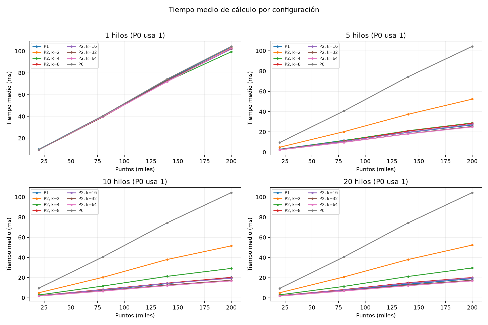
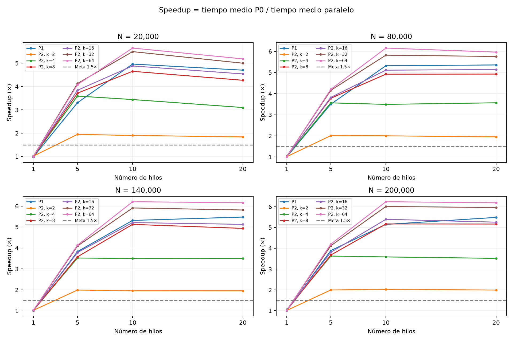
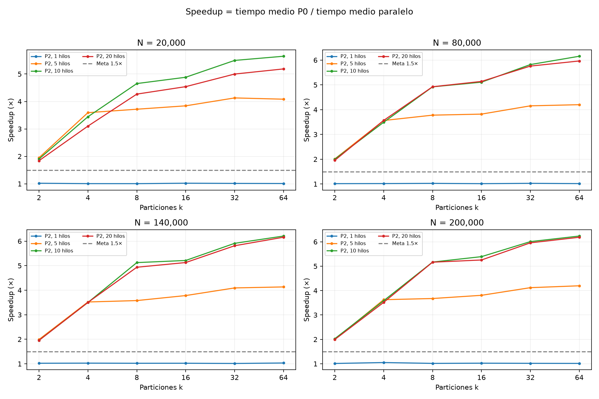

# Evaluación experimental individual

En este informe reporto la campaña del 15 de octubre de 2026: **116 configuraciones, diez repeticiones cada una, 1160 mediciones válidas. N={20000,80000,140000,200000}, T={1,5,10,20}, k={2,4,8,16,32,64}; epsilon=0.03, min_samples=10. Conservo todas las configuraciones y mediciones, incluidas las menos favorables.

Archivos: [tiempos individuales](../results/benchmarks/e5129e76b440779f/raw.csv), [resumen](../results/benchmarks/e5129e76b440779f/summary.csv), [metadatos](../results/benchmarks/e5129e76b440779f/metadata.json), [validación](../results/benchmarks/e5129e76b440779f/validation.csv).

## Mejores medias observadas por versión y tamaño

Seleccioné la mejor configuración de cada versión y tamaño con un fin descriptivo. Para cada media utilicé las diez repeticiones, sin eliminar mediciones. La desviación estándar describe variabilidad, no un intervalo de confianza.

| N | Versión | Hilos | k | Media (ms) | Desv. estándar (ms) | Speedup | Eficiencia |
|---:|---|---:|---:|---:|---:|---:|---:|
| 20000 | serial | 1 | — | 9.4525 | 0.1542 | 1.000× | 100.00% |
| 20000 | paralelo1 | 10 | — | 1.9046 | 0.0743 | 4.963× | 49.63% |
| 20000 | paralelo2 | 10 | 64 | 1.6737 | 0.0798 | 5.648× | 56.48% |
| 80000 | serial | 1 | — | 40.5661 | 0.6320 | 1.000× | 100.00% |
| 80000 | paralelo1 | 20 | — | 7.5737 | 0.1274 | 5.356× | 26.78% |
| 80000 | paralelo2 | 10 | 64 | 6.5907 | 0.2365 | 6.155× | 61.55% |
| 140000 | serial | 1 | — | 74.3209 | 1.9423 | 1.000× | 100.00% |
| 140000 | paralelo1 | 20 | — | 13.5729 | 0.1850 | 5.476× | 27.38% |
| 140000 | paralelo2 | 10 | 64 | 11.9734 | 0.2083 | 6.207× | 62.07% |
| 200000 | serial | 1 | — | 104.3382 | 3.1925 | 1.000× | 100.00% |
| 200000 | paralelo1 | 20 | — | 19.0317 | 0.4159 | 5.482× | 27.41% |
| 200000 | paralelo2 | 10 | 64 | 16.7330 | 0.3900 | 6.235× | 62.35% |

## Interpretación

Observé que ambas versiones paralelas superaron el requisito de speedup 1.5 en los cuatro tamaños. P2 con 10 hilos y k=64 obtuvo la mejor media en todos ellos: de 5.65× a 6.24×. En 200000 puntos, P0 tomó 104.34 ms, la mejor P1 19.03 ms y la mejor P2 16.73 ms. P2 redujo el tiempo frente a la mejor P1 aproximadamente un 12.1%.

P2 con k=2 se mantiene cerca de 2× al añadir hilos, coherente con su límite de dos bloques disponibles por fase. Con k=32 o 64 hay más bloques para repartir; interpreto la mejora como compatible con mejor balance, aunque no medí el tiempo por hilo para atribuirle causalidad definitiva.

P1 alcanzó su mejor media con 20 hilos en los tres tamaños mayores. Esto no implica disponer de 20 núcleos: son 20 hilos sobre 10 procesadores lógicos. P2 alcanzó sus mejores medias con 10 hilos; sobresuscribir a 20 no mejoró esos resultados. La eficiencia de P2 a 200000 puntos fue 62.35% con 10 hilos, frente a 27.41% de la mejor P1 con 20.

El tiempo crece aproximadamente con N en estos datos densos porque la búsqueda se detiene al alcanzar min_samples. El peor caso del algoritmo sigue siendo O(N²); no generalizo esta tendencia a puntos aislados o parámetros diferentes. La estimación previa N² de 7.60 minutos era orientativa, no una medición del tiempo total.

## Verificación

Antes de medir repetí los ocho casos de referencia con scikit-learn. Después utilicé scripts/auditar_experimentos.py para verificar hashes de ejecutables y datasets, tiempos positivos y finitos, diez repeticiones distintas por configuración, medias, speedup y eficiencia. Mediante ese script reejecuté las 116 configuraciones con salida CSV y comprobé igualdad exacta frente a P0 en cada tamaño, además de coordenadas originales y número efectivo de hilos. Excluí esas ejecuciones de auditoría de los tiempos experimentales. Utilicé sklearn como referencia externa en los ocho casos documentados y comparé los cuatro datasets grandes contra P0.

| N | Core | Segundo orden | Ruido |
|---:|---:|---:|---:|
| 20000 | 19866 | 89 | 45 |
| 80000 | 79885 | 81 | 34 |
| 140000 | 139896 | 69 | 35 |
| 200000 | 199902 | 77 | 21 |

## Gráficas







## Reproducir y auditar

```sh
.venv/bin/python scripts/experimentos.py --full --individual --run
.venv/bin/python scripts/auditar_experimentos.py results/benchmarks/e5129e76b440779f
.venv/bin/python scripts/graficas.py results/benchmarks/e5129e76b440779f/summary.csv
```

Con la primera orden reanudo resultados compatibles sin repetir mediciones completas. Para una campaña nueva añado --force. Durante la campaña reportada mantuve el mismo código C++ y los mismos ejecutables, sin recompilarlos.

Conservo el piloto anterior y su registro de fases en [resultados_piloto.md](resultados_piloto.md). Presento ambos registros por separado para distinguir las mediciones preliminares de esta evaluación.
