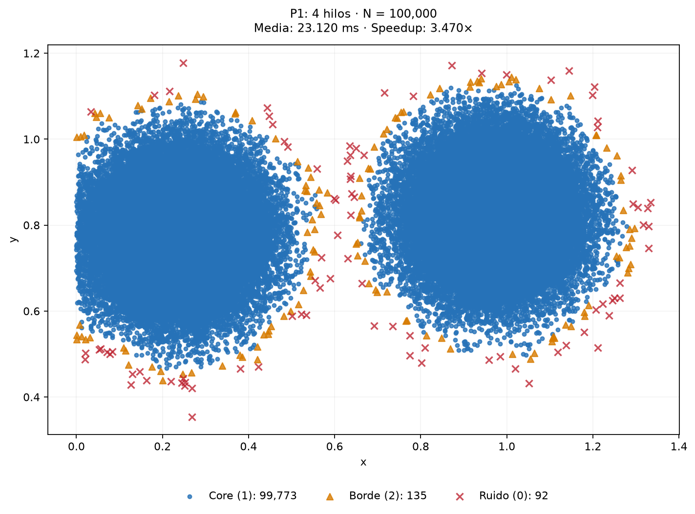

# Comparación para la demostración

Comparé 100,000 puntos con epsilon=0.03 y min_samples=10. Descarté un calentamiento por versión y medí 10 repeticiones por configuración. P1 y P2 produjeron clasificaciones idénticas a P0. Comparo tiempos internos de cómputo; la lectura, escritura y las gráficas quedan fuera.

| Versión | Hilos | k | Media (ms) | DE (ms) | Speedup | Eficiencia |
| --- | ---: | ---: | ---: | ---: | ---: | ---: |
| P0: serial | 1 | - | 80.227 | 0.501 | 1.000× | 100.00% |
| P1: 4 hilos | 4 | - | 23.120 | 0.308 | 3.470× | 86.75% |
| P2: 4 hilos, 4 particiones | 4 | 4 | 22.575 | 0.173 | 3.554× | 88.84% |

Speedup = media serial / media de la versión. Eficiencia = speedup / hilos.

DE es la desviación estándar muestral. Los colores representan core, borde y ruido.

## P0: serial

## P1: 4 hilos

## P2: 4 hilos, 4 particiones

